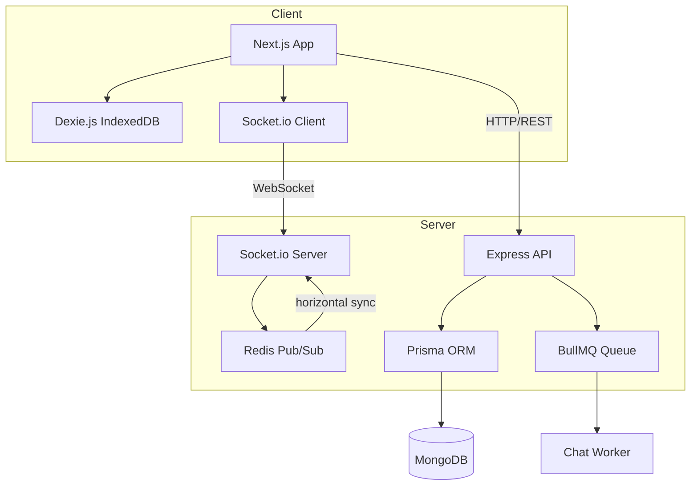

# Quick Chat

A real-time messaging platform built with modern web technologies. Designed for high concurrency, offline resilience, and sub-100ms message delivery.

## Tech Stack

| Layer | Technology |
|-------|-----------|
| Client | Next.js 15, React 19, TypeScript, Tailwind CSS, Zustand |
| Server | Node.js, Express, TypeScript, Prisma |
| Database | MongoDB |
| Cache | Redis (Upstash) |
| Realtime | Socket.io with Redis Pub/Sub |
| Queue | BullMQ (Redis-backed) |
| Offline | IndexedDB (Dexie.js) |

## Architecture



## Quick Start

```bash
# Clone
git clone <repo-url> && cd quick-chat

# Backend
cd server && pnpm install && pnpm run dev

# Frontend (new terminal)
cd client && pnpm install && pnpm run dev
```

Open [http://localhost:3000](http://localhost:3000).

## Documentation

| Document | Description |
|----------|-------------|
| [Architecture](docs/ARCHITECTURE.md) | High-level system design and component relationships |
| [System Design](docs/SYSTEM_DESIGN.md) | Auth flow, message lifecycle, cache strategy |
| [Message Flow](docs/MESSAGE_FLOW.md) | End-to-end message delivery with sequence diagrams |
| [Engineering Decisions](docs/ENGINEERING_DECISIONS.md) | Tradeoffs and rationale for technology choices |
| [API Reference](docs/API.md) | Complete REST and WebSocket API documentation |
| [Deployment](docs/DEPLOYMENT.md) | Environment setup, Docker, production build |
| [Performance](docs/PERFORMANCE.md) | Optimizations, caching, scalability |
| [Performance Engineering](docs/PERFORMANCE_ENGINEERING.md) | Reconnect resilience, instrumentation, fanout hot spots |
| [Security](docs/SECURITY.md) | Auth, validation, attack prevention |
| [Client Docs](client/README.md) | Frontend architecture and component structure |
| [Server Docs](server/README.md) | Backend modules, services, and infrastructure |

## Folder Structure

```
/
├── client/          # Next.js 15 frontend
├── server/          # Node.js + Express backend
├── docs/            # Engineering documentation
├── .nvmrc           # Node version (22)
└── .gitattributes   # LF normalization
```

## License

MIT
