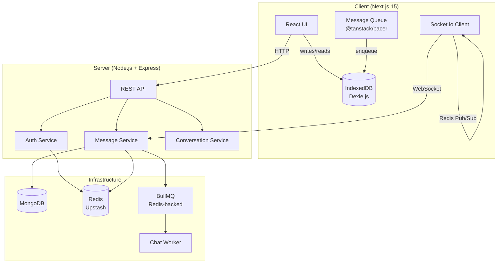
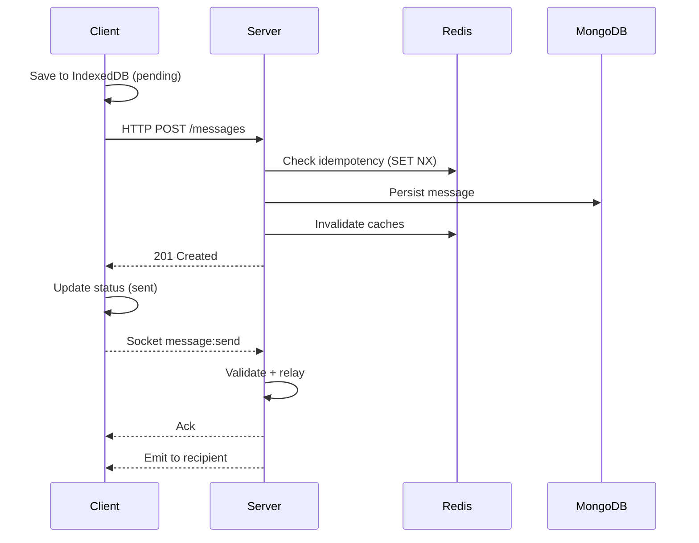
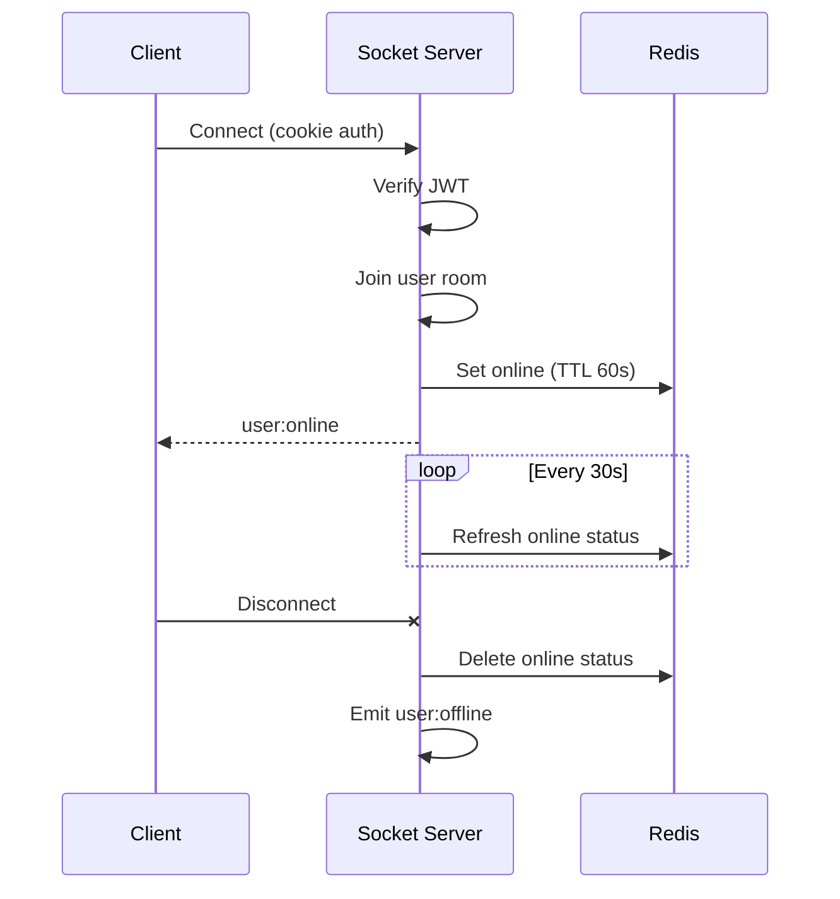

# Architecture

> High-level system design and component relationships.

[← Index](INDEX.md) · [System Design →](SYSTEM_DESIGN.md)

## System Overview

Quick Chat follows a client-server architecture with a local-first messaging strategy. The client handles message persistence and UI rendering, while the server manages authentication, message routing, and horizontal scaling.



## Components

### Client

| Component | Responsibility |
|-----------|---------------|
| **React UI** | Renders chat interface, conversation list, contacts |
| **IndexedDB (Dexie.js)** | Local message persistence for offline support and optimistic updates |
| **Socket.io Client** | Real-time bidirectional communication |
| **Message Queue** | Buffers outbound messages with retry logic when offline |

### Server

| Component | Responsibility |
|-----------|---------------|
| **REST API** | Authentication, conversation CRUD, message history, contacts |
| **Socket.io Server** | Real-time message relay, status updates, presence |
| **Auth Service** | JWT token management, session lifecycle, single-device enforcement |
| **Message Service** | Message persistence, cache invalidation, delivery tracking |
| **Conversation Service** | Conversation creation, read receipts, participant management |

### Infrastructure

| Component | Responsibility |
|-----------|---------------|
| **MongoDB** | Primary data store for users, messages, conversations |
| **Redis (Upstash)** | Caching layer, rate limiting, session management, idempotency keys |
| **BullMQ** | Background job processing for notifications and analytics |
| **Redis Pub/Sub** | Horizontal scaling of Socket.io across multiple server instances |

## Data Flow

### Message Send



### Connection Lifecycle



## Module Boundaries

```
server/src/modules/
├── auth/          # Authentication + authorization
├── user/          # User profiles + push subscriptions
├── message/       # Message CRUD + delivery tracking
├── conversation/  # Chat rooms + read receipts
└── contact/       # Contact management + search
```

Each module follows the same internal structure:

```
module/
├── *.controller.ts   # HTTP request handling
├── *.service.ts      # Business logic
├── *.repository.ts   # Database queries
├── *.route.ts        # Route definitions + middleware
└── *.dto.ts          # Request validation schemas
```

## Related Documentation

- [System Design](SYSTEM_DESIGN.md) — Detailed flow diagrams
- [Server README](../server/README.md) — Backend infrastructure
- [Client README](../client/README.md) — Frontend architecture
