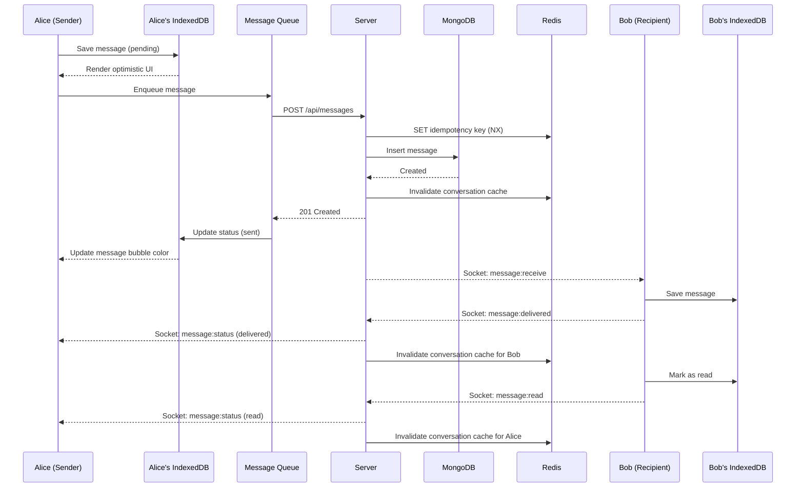
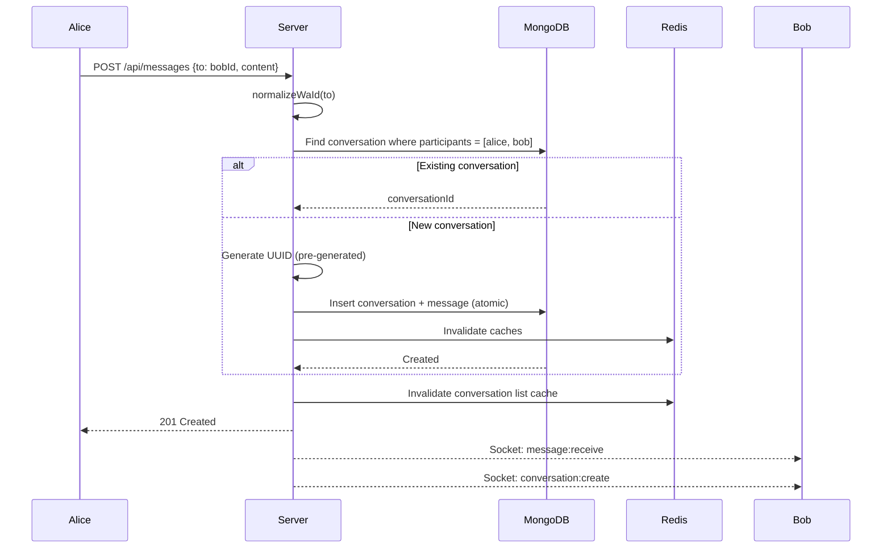
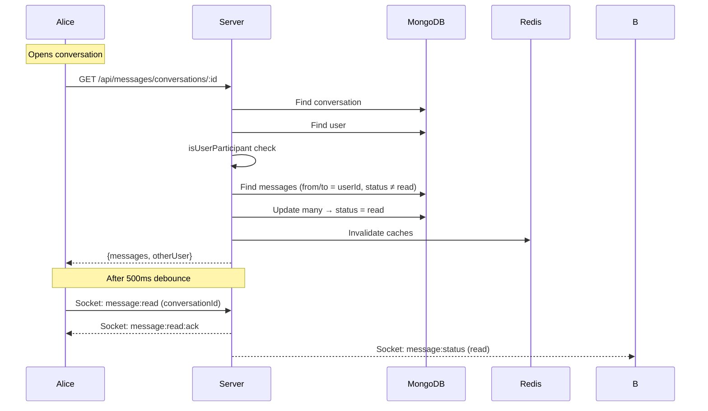
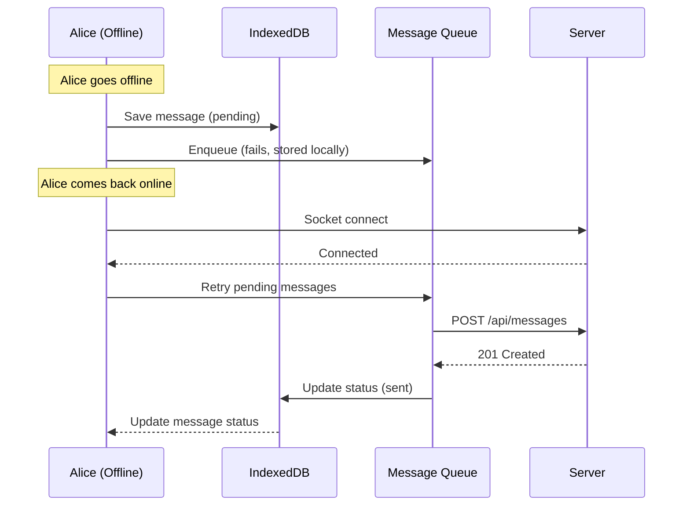
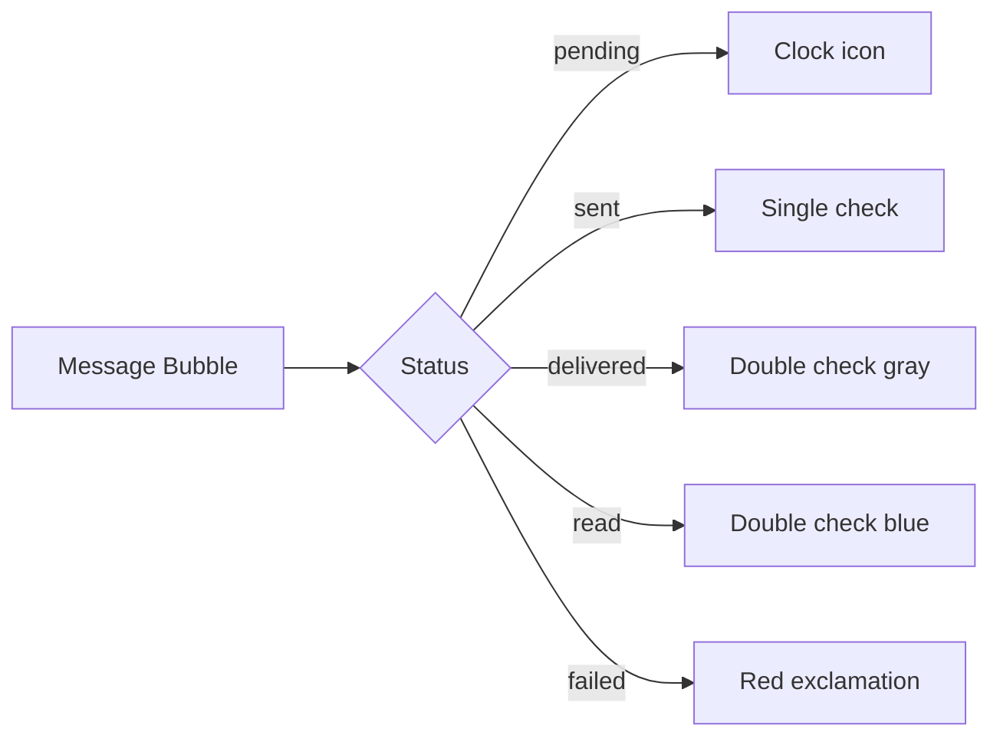

# Message Flow

> End-to-end message delivery with sequence diagrams.

[← System Design](SYSTEM_DESIGN.md) · [Engineering Decisions →](ENGINEERING_DECISIONS.md)

## Happy Path: Send & Receive



## Conversation Creation



## Read Receipts



## Offline Recovery



## Message Deduplication

Messages can arrive via both HTTP response and WebSocket. The client handles this:

```typescript
// client/hooks/useMessageHandler.ts
const handleMessageReceive = useCallback((message) => {
  if (conversationId && message.conversationId === conversationId) {
    addMessage(message); // Zustand store handles dedup by ID
  }
}, [conversationId]);
```

The `addMessage` function checks if a message with the same `id` already exists before adding.

## Delivery Status UI



## Related Documentation

- [System Design](SYSTEM_DESIGN.md) — Auth and caching flows
- [API Reference](API.md) — HTTP and WebSocket endpoints
- [Client README](../client/README.md) — useMessageHandler hook
