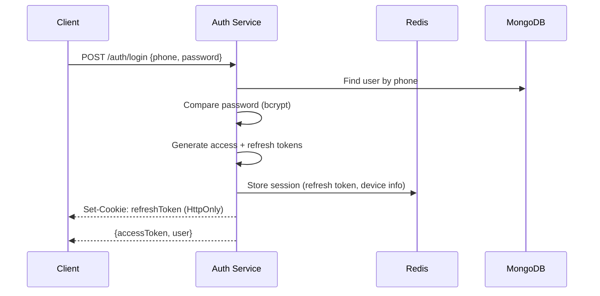
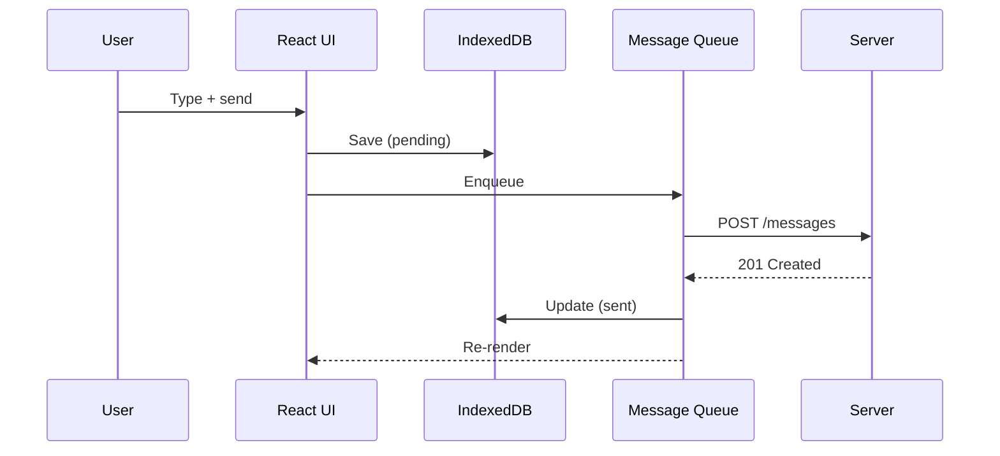
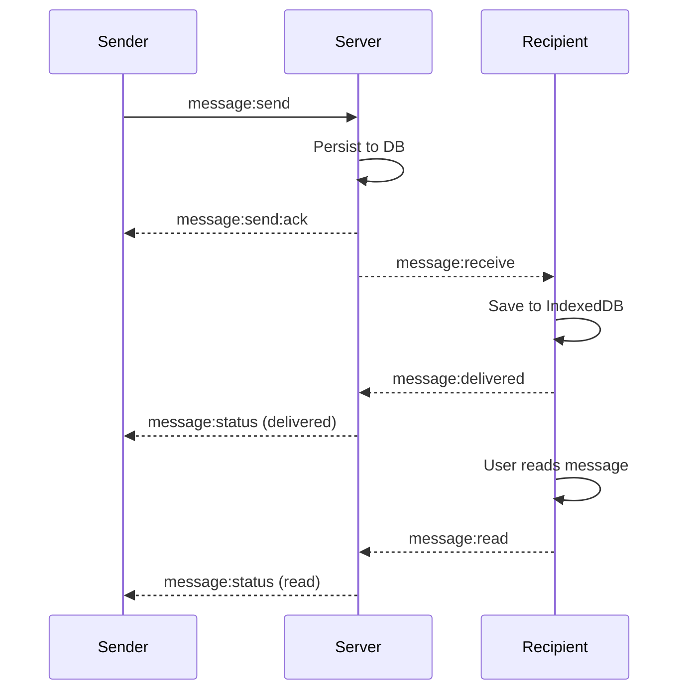
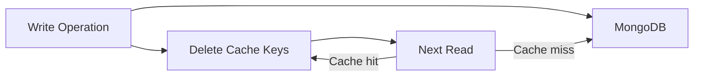

# System Design

> Authentication, message lifecycle, caching, and offline-first design.

[← Architecture](ARCHITECTURE.md) · [Message Flow →](MESSAGE_FLOW.md)

## Authentication

### JWT Token Strategy



**Token lifecycle:**
- **Access token**: 15-minute expiry, stateless, carries user ID
- **Refresh token**: 7-day expiry, stored in Redis, single-device enforcement
- **Rotation**: On refresh, old refresh token is invalidated, new pair issued
- **Revocation**: Logout deletes refresh token from Redis, invalidating the session

### Single-Device Enforcement

Each refresh token is stored with a device identifier. When a new login occurs on a different device, the previous session's refresh token is deleted, forcing re-authentication on the old device.

## Message Lifecycle

### States

```
pending → sent → delivered → read
   ↓        ↓        ↓
 failed   failed   failed
```

| State | Meaning |
|-------|---------|
| `pending` | Stored in IndexedDB, not yet sent to server |
| `sent` | Server acknowledged receipt |
| `delivered` | Recipient's client confirmed download |
| `read` | Recipient viewed the message |
| `failed` | Delivery failed after retry attempts |

### Optimistic Updates

Messages are saved to IndexedDB immediately with `pending` status. The UI renders them instantly. On server acknowledgment, the status updates in-place. On failure, a retry indicator appears.



### Delivery Confirmation



## Caching Strategy

### What Gets Cached

| Key Pattern | TTL | Invalidation |
|------------|-----|-------------|
| `user:{id}` | 1 hour | On profile update |
| `conversation:{id}:messages` | 5 minutes | On new message |
| `user:{id}:conversations` | 5 minutes | On new conversation or message |
| `user:{id}:online` | 60 seconds | Heartbeat refresh, delete on disconnect |

### Invalidation Pattern

Write-through invalidation: after any write operation, the relevant cache keys are deleted. Subsequent reads fetch fresh data from MongoDB and repopulate the cache.



### Circuit Breaker

Redis operations are wrapped in a circuit breaker (3 failures → 30s open → half-open probe). When the circuit is open, operations bypass the cache and read directly from MongoDB. This prevents Redis outages from cascading to API failures.

## Offline-First Design

### IndexedDB Schema (Dexie.js)

```
messages: id, conversationId, from, to, content, status, timestamp, serverId
conversations: id, name, participants, lastMessage, unreadCount, updatedAt
contacts: id, name, phone, about, avatarUrl, isUser
```

### Sync Strategy

1. **On connect**: Fetch latest messages via REST, merge with local
2. **On message receive**: Write to IndexedDB, update UI
3. **On send**: Write to IndexedDB (pending), enqueue for server delivery
4. **On reconnect**: Retry failed messages from queue

### Conflict Resolution

Messages use server-generated IDs and timestamps. The client generates temporary UUIDs that are replaced with server IDs on acknowledgment. No client-side conflict resolution is needed because the server is the source of truth.

## Rate Limiting

| Endpoint | Limit | Window |
|----------|-------|--------|
| `POST /auth/login` | 5 requests | 1 minute |
| `POST /auth/register` | 3 requests | 5 minutes |
| `POST /messages` | 30 requests | 1 minute |
| `POST /auth/refresh` | 10 requests | 1 minute |
| Socket `message:send` | 60 events | 1 minute |

Rate limiting uses a sliding window counter in Redis. When the limit is exceeded, the server responds with `429 Too Many Requests`.

## Related Documentation

- [Message Flow](MESSAGE_FLOW.md) — Detailed delivery sequence diagrams
- [Performance](PERFORMANCE.md) — Caching optimization details
- [Security](SECURITY.md) — Auth security details
